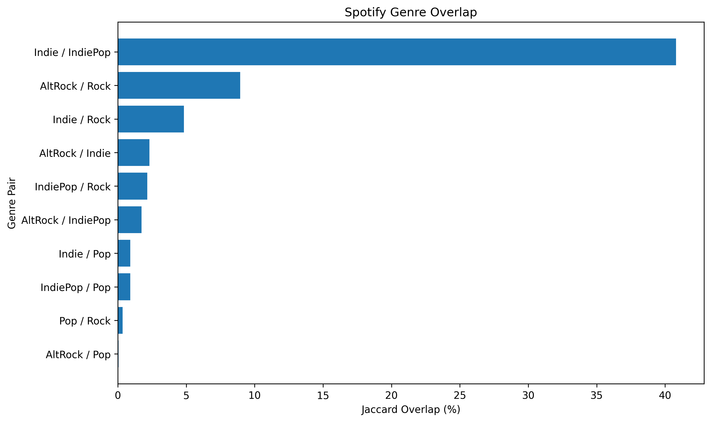
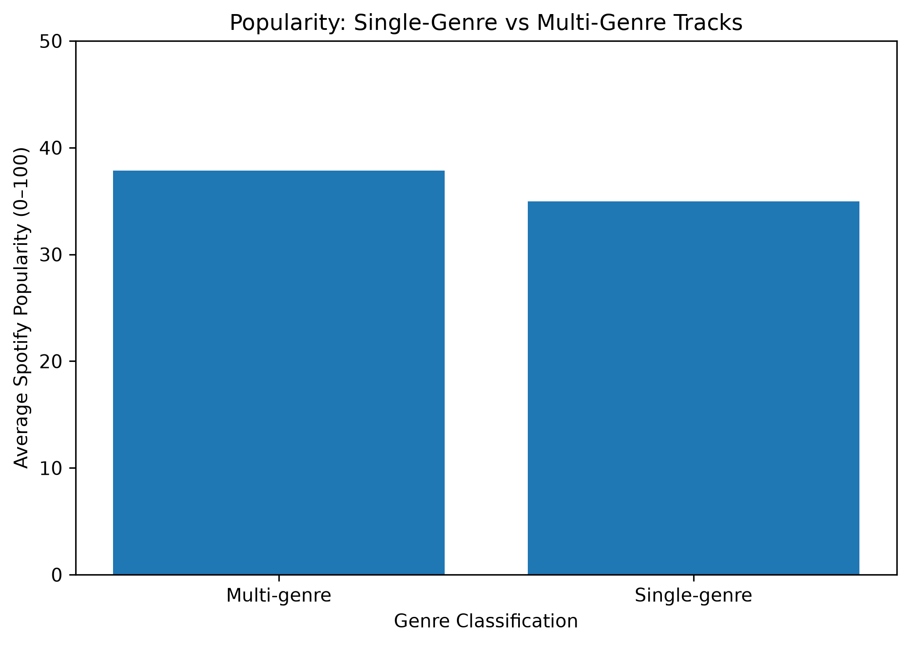

# Spotify Music Knowledge Graph

**Exploring genre overlap, track popularity, and semantic reasoning with RDF, OWL, SPARQL, and Python.**

Music genres are not always mutually exclusive. A track can appear under several genre labels, which raises two questions: **where do genres overlap most, and are multi-genre tracks more popular?** This project explores those questions by transforming Spotify track data into a knowledge graph and querying the relationships between tracks, artists, albums, and genres.

Built as part of a independent university *Knowledge & Data* project, with a focus on ontology design, data preparation, knowledge representation, and analysis.

## Project at a glance

| Metric | Result |
| --- | ---: |
| Genres analysed | 5 |
| Source records after filtering | 5,000 |
| Unique tracks represented | 4,088 |
| Artists represented | 1,619 |
| Albums represented | 3,419 |
| Track–genre relationships | 4,989 |
| RDF triples in the instance graph | 31,762 |

**Genres:** Pop, Rock, Alt-Rock, Indie, and Indie-Pop.

## What I built

The project follows a data-to-knowledge-graph workflow:

1. **Prepare the data:** Filter the Spotify dataset to five genres using Pandas. Group repeated Spotify track IDs so that one song is represented once while retaining all its genre associations. For tracks with conflicting popularity values, use the rounded average.
2. **Model the domain:** Design an OWL ontology in Protégé with classes for `MusicTrack`, `Artist`, `Album`, and `Genre`, plus relationships such as `hasGenre`, `performedBy`, and `belongsToAlbum`.
3. **Generate RDF:** Use Python and RDFLib to create track, artist, and album individuals and export the data in Turtle (`.ttl`) format.
4. **Query and analyse:** Run SPARQL queries to count shared tracks, calculate Jaccard overlap between genre pairs, and compare average popularity for single-genre and multi-genre tracks.
5. **Explore reasoning:** Use OWL class restrictions and the HermiT reasoner in Protégé to infer additional track classifications. Reasoning was demonstrated on a smaller sample rather than the entire graph.

## Key findings

### 1. Some genres overlap substantially more than others

| Genre pair | Shared tracks | Jaccard overlap |
| --- | ---: | ---: |
| Indie / Indie-Pop | 579 | 40.80% |
| Alt-Rock / Rock | 164 | 8.94% |
| Indie / Rock | 92 | 4.83% |

Indie and Indie-Pop had the strongest overlap among the five selected genres. Jaccard similarity measures the number of shared tracks relative to the total number of distinct tracks in both categories.

### 2. Multi-genre tracks had slightly higher average popularity

| Track group | Number of tracks | Average popularity |
| --- | ---: | ---: |
| Single-genre | 3,281 | 34.98 |
| Multi-genre | 807 | 37.83 |

The difference was **2.85 popularity points** within this dataset. This is a descriptive comparison, **not evidence that belonging to multiple genres causes greater popularity**.

### 3. Ontology reasoning can infer new classifications

The ontology defines, among others:

- `MultiGenreTrack`: a `MusicTrack` associated with at least two distinct `Genre` individuals.
- `PopularTrack`: a `MusicTrack` with a popularity score of **70 or higher** (a threshold chosen for this project).

For example, **“Mr. Brightside” by The Killers** is connected to both Rock and Alt-Rock and has a popularity score of 86 in the project data. HermiT inferred that the track belongs to both `MultiGenreTrack` and `PopularTrack` in the reasoning sample.

## Example SPARQL query

The following query finds pairs of genres that share tracks:

```sparql
PREFIX spotify: <http://www.semanticweb.org/vishwasdubey/ontologies/2026/9/untitled-ontology-5/>

SELECT ?genre1 ?genre2 (COUNT(DISTINCT ?track) AS ?sharedTracks)
WHERE {
    ?track a spotify:MusicTrack ;
           spotify:hasGenre ?genre1, ?genre2 .
    FILTER(STR(?genre1) < STR(?genre2))
}
GROUP BY ?genre1 ?genre2
ORDER BY DESC(?sharedTracks)
```

The string comparison avoids counting the same genre pair twice in reverse order; `COUNT(DISTINCT ?track)` prevents duplicate track counts.

## Results & Visualisations

### Genre Overlap



Indie and Indie-Pop showed the highest overlap,
with a Jaccard similarity of 40.80%.

### Popularity Comparison



Multi-genre tracks had an average popularity
score of 37.83, compared with 34.98 for
single-genre tracks.

## Technologies

- **Python** — data preparation, RDF construction, and analysis
- **Pandas** — filtering, grouping, and cleaning tabular data
- **RDFLib** — creating RDF graphs and executing SPARQL queries
- **RDF / RDFS / OWL / Turtle** — knowledge graph representation and ontology modelling
- **SPARQL** — relationship queries and aggregate analysis
- **Protégé + HermiT** — ontology editing and logical reasoning
- **Matplotlib and Jupyter Notebook** — analysis and visualisations

## Repository files

| File | Purpose |
| --- | --- |
| `Spotify_Analysis.ipynb` | Python notebook for data preparation, graph construction, SPARQL analysis, and charts |
| `Ontology.ttl` | OWL ontology: classes, properties, and restrictions |
| `instances.ttl` | Generated RDF instances for tracks, artists, albums, and genre relationships |
| `spotify_5_genres.csv` | Filtered five-genre dataset, if included in the repository |
| `spotify_combined.ttl` | Combined ontology and instance graph, if included |
| `spotify_reasoning_sample.ttl` | Smaller graph used for reasoning, if included |
| `genre_overlap.png`, `genre_popularity.png` | Result charts, if included |

The original `dataset.csv` is sourced separately (see **Data source** below). It is not required to be stored in this repository if you download it yourself.

## Running the project

1. Install Python 3 and Jupyter Notebook.
2. Install the required Python libraries:

   ```bash
   pip install pandas rdflib matplotlib notebook
   ```

3. Download the [Spotify Tracks Dataset](https://huggingface.co/datasets/maharshipandya/spotify-tracks-dataset) and save its CSV as `dataset.csv` alongside the notebook. If you have already generated `spotify_5_genres.csv`, keep that file in the same directory too.
4. Keep `Ontology.ttl` and `instances.ttl` in the same directory as `Spotify_Analysis.ipynb`.
5. Start Jupyter and open `Spotify_Analysis.ipynb`:

   ```bash
   jupyter notebook
   ```

6. Follow the notebook's data preparation, RDF generation, and SPARQL analysis cells. The notebook also contains exploratory/debugging cells; check filenames and capitalization if your operating system treats `Ontology.ttl` and `ontology.ttl` as different files.

For logical reasoning, open the ontology together with the instance data (or the smaller reasoning sample) in **Protégé**, then run **HermiT**. The reasoning demonstration uses a reduced sample because running the reasoner on the full graph was challenging.

## Scope and limitations

- The analysis is limited to **five selected genre labels**, not all genres in the source dataset.
- The popularity comparison is observational; it does not establish causation.
- Duplicate track IDs were consolidated and conflicting popularity values averaged, so the results reflect these preprocessing decisions.
- OWL reasoning was tested on a smaller sample, rather than exhaustively on the full dataset.

## Data source and references

- [Spotify Tracks Dataset — maharshipandya (Hugging Face)](https://huggingface.co/datasets/maharshipandya/spotify-tracks-dataset)
- [RDFLib documentation](https://rdflib.readthedocs.io/)
- [Protégé ontology editor](https://protege.stanford.edu/)
- [Schema.org music vocabulary](https://schema.org/MusicRecording)

*This is an independent educational analysis using a publicly available Spotify tracks dataset; it is not an official Spotify project.*
